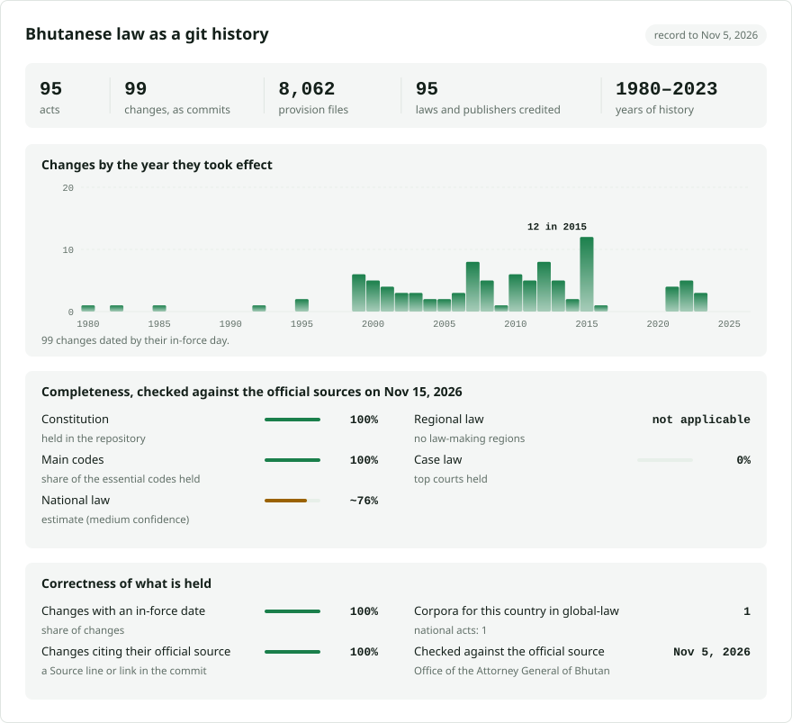

# Bhutan: law history in git

<picture>
<source media="(prefers-color-scheme: dark)" srcset="data/effort-dark.svg">

</picture>

The law of Bhutan as a git history: one file per section, one commit per version on the day it took effect, and the Act that made each change as the commit's author. `git blame` names the Act behind every line; `git log` lists every change to a section; picking a date gives the text held for that day. The Office of the Attorney General publishes each Act as enacted and no consolidated texts, so each Act here is its text as enacted; amending Acts are held as their own texts and are not applied to the Acts they amend.

Part of [lexifina/global-law](https://github.com/lexifina/global-law), one git history for every country's law: this is Bhutan's national law, which global-law reads at `bhutan/national/acts/`.

**What is in it now:** the Constitution of 2008 and 94 Acts from the Office of the Attorney General's Depository of Laws, in force from 1980 to 2023, each in its English text as enacted (18 of them amending Acts); 5 of the Acts have a second, empty version from the day another Act repealed them, so there are 100 versions, and 89 Acts have text on `main`. [`data/laws.csv`](data/laws.csv) lists every Act with its dates and source PDF.

Each Act is in `act/<year>/<name>/`, by the year in its title, one file per section, with the text before the first section in `front.md` (`act/2011/anti-corruption/` is the Anti Corruption Act 2011); 14 Acts whose sections do not split cleanly are one `text.md`, among them the Labour and Employment Act of Bhutan 2007 (`act/2007/labour-and-employment-act-of-bhutan/text.md`). The Constitution is `constitution/constitution/`, one file per Article; the Penal Code, the Civil and Criminal Procedure Code and the Contract Act keep their first folders (`penal-code/`, `civil-criminal-procedure/`, `contract-act/`), and the repealed Acts' folders keep only a README. [`data/paths.json`](data/paths.json) maps each Act id to its folder.

The text is in English, as the Office publishes it. Many Acts say their Dzongkha text prevails where the two differ (the Constitution makes both equally authoritative); the Dzongkha text is not part of this record.

## Questions as git commands

| Question | Command |
| --- | --- |
| Every change to the Labour and Employment Act | `git log -p --word-diff --follow -- act/2007/labour-and-employment-act-of-bhutan/text.md` |
| Which Act wrote each line of the Labour and Employment Act? | `git blame act/2007/labour-and-employment-act-of-bhutan/text.md` |
| Every version of the Labour and Employment Act, with the day each took effect | `git log --follow --diff-filter=AMD --format="%h %(trailers:key=In-force,valueonly,separator=) %an" -- act/2007/labour-and-employment-act-of-bhutan/text.md` |
| The Labour and Employment Act's text on 1 January 2015 | `python tools/on.py 2015-01-01 act/2007/labour-and-employment-act-of-bhutan` |

`--follow` reads through the commit of 2026-11-10 that moved the Act folders to `act/<year>/<name>/` and changed no text.

**Outside git**, we also host this record publicly, for free:

- **[Ask Claude about Bhutanese law](https://global-law.lexifina.com/v1/try_claude?country=bhutan)**: opens Claude with a first question ready.
- **[Ask ChatGPT](https://global-law.lexifina.com/v1/try_chatgpt?country=bhutan)**: the same question in ChatGPT.
- **[Search Bhutanese law on our site](https://lexifina.com/law?country=bhutan&q=annual+leave)**: a search for "annual leave", with each provision's text and its versions, no account needed.
- **[Developer REST API](https://global-law.lexifina.com/v1/search_law?query=annual+leave&jurisdiction=bhutan)**: the same search as JSON, with no key. See the [documentation here](https://lexifina.com/api/global-law).

Both assistants read the record through the free Global law connector (MCP, `https://global-law.lexifina.com/mcp`); the first time, the chat gives you the link that adds it. Ask in English.

**Host it yourself easily.** All it takes is git and Python, and the tools run on your machine:

```sh
git clone --depth 1 https://github.com/lexifina/global-law && cd global-law
python3 tools/countries.py add bhutan/national/acts
python3 tools/law.py show 2026-01-01 bhutan/national/acts/act/2007/labour-and-employment-act-of-bhutan/text.md
```

Opened in Claude Code, Cursor, VS Code or Codex, the clone also starts a local MCP server with the same tools ([MCP.md](https://github.com/lexifina/global-law/blob/main/MCP.md)).

## Dates

Each law commit is dated at noon, Asia/Thimphu (UTC+6), on the day the version took effect, and carries it in its `In-force:` trailer:

- for an Act as enacted, the commencement date its own text prints (the Gregorian date after "corresponding to"), or the date of passing it prints when it gives none; the Bhutanese-calendar date is kept as text, never converted;
- for a repeal, the day the repealing Act's words give: the Local Government Act of Bhutan 2009 repeals the Local Governance Act 2007 and the Dzongkhag Yargay Tshogdu Chathrim 2002 upon enactment, 11 September 2009, although it commenced on 15 March 2010;
- the date of passing is also the `Enacted:` trailer and the `enacted` column of `data/laws.csv`.

Each Act as enacted is credited to the Act itself (`Labour and Employment Act of Bhutan 2007`), and each repeal to the Act that made it (`Local Government Act of Bhutan 2009`).

## How it is checked

- Each text is read by deterministic code from the text layer of the Office's English PDF, with no OCR and no model; [`data/versions.json`](data/versions.json) has the sha256 of the PDF behind every version.
- An Act split into sections is kept only if they are numbered without a gap and hold every word of the source's English lines, in order and with none added.
- `tools/check_repo.py` reads every version back from git on the day it took effect and on the day before, and compares it with the corpus (its run is not yet recorded in [`REPRODUCE.md`](REPRODUCE.md)); a second build from the same corpus gave identical hashes for all 99 law commits and 195 tags.
- History is append-only: new Acts and versions go on top (`tools/append.py`), and no published commit is rewritten.
- [vulnerabilities/](vulnerabilities/README.md): possible drafting mistakes in Bhutanese law, found by global-law's detectors and checked by hand.

## What it does not show

- **Amendments applied.** An amended Act shows its wording as enacted: the Penal Code (2004) and the Civil and Criminal Procedure Code (2001) are here without their Amendment Acts of 2011 and 2021; three of those four are here as their own texts, and the Penal Code's of 2011 is not.
- **Acts left out:** Acts the Depository has only as scans or only in Dzongkha, Acts that print no Gregorian date, Acts whose text does not read cleanly from the PDF, most Acts that a later Act in the Depository supersedes or repeals, and the narcotics Act of 2005 and the Thromde Act 2007, whose effective dates are not established.
- **Some repeals.** The Bhutan Municipal Act 1999 has no repeal version: the Thromde Act 2007 repeals it but prints no commencement date.
- **The Dzongkha text**, rules and regulations, case law, treaties and bills.

## Sources

| Source | Kind | Past versions | Notes |
| --- | --- | --- | --- |
| [Depository of Laws](https://oag.gov.bt/?page_id=7854) (Office of the Attorney General) | The Constitution and Acts as enacted, in English and Dzongkha PDFs | no, each Act as enacted; no consolidated texts | Only the English text layer is read |

## Licence

See [`LICENSE`](LICENSE). Section 7(b) of the Copyright Act of the Kingdom of Bhutan, 2001 extends no protection to "any official text of a legislative, administrative or legal nature, as well as any official translation thereof"; the texts are copied unaltered apart from layout, with attribution to the Office of the Attorney General. Lexifina's arrangement, commit messages and tools may be reused under CC BY 4.0.

No AI model wrote, translated or corrected legal text, and no model runs when the history is built; the scripts were written by AI models (Claude, and OpenAI Codex for the PDF reading) under Lexifina's direction (see [`REPRODUCE.md`](REPRODUCE.md)).

## More

From [lexifina/global-law](https://github.com/lexifina/global-law):

- [FEATURES.md](https://github.com/lexifina/global-law/blob/main/FEATURES.md): every feature, and what every corpus must support (`git blame`, `law.py`, the MCP tools)
- [FAQ.md](https://github.com/lexifina/global-law/blob/main/FAQ.md): questions and answers · [CONTRIBUTING.md](https://github.com/lexifina/global-law/blob/main/CONTRIBUTING.md): proposing changes · [MCP.md](https://github.com/lexifina/global-law/blob/main/MCP.md): the MCP server · [REPRODUCE.md](https://github.com/lexifina/global-law/blob/main/REPRODUCE.md): how it was built · [CHANGELOG.md](https://github.com/lexifina/global-law/blob/main/CHANGELOG.md)
- [FRESHNESS.md](https://github.com/lexifina/global-law/blob/main/FRESHNESS.md): how current each corpus is · [Monitoring](https://github.com/lexifina/global-law/tree/main/monitoring): whether updates are running · [WATCHING.md](https://github.com/lexifina/global-law/blob/main/WATCHING.md): how each official source is watched for changes
- [performance/](https://github.com/lexifina/global-law/tree/main/performance): how fast the tools are, measured
- [visualisations/](https://github.com/lexifina/global-law/tree/main/visualisations): charts and bridges across the world's law
- [Vulnerabilities](https://github.com/lexifina/global-law/tree/main/vulnerabilities): mistakes in legislation as published
